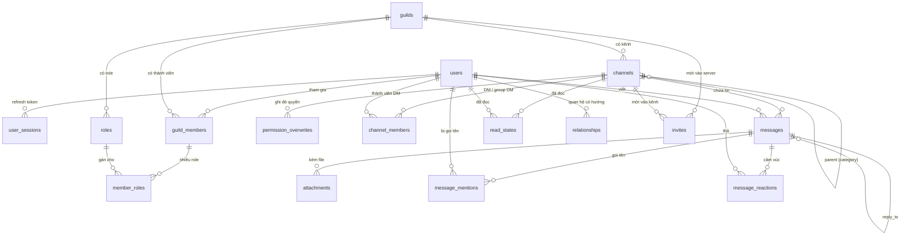

# Umaru — Data Model (G0)

> DDL đầy đủ: [db/migrations/0001_init.sql](../db/migrations/0001_init.sql)
> Engine mục tiêu: **PostgreSQL 16+** trên Neon free tier (ROADMAP §4.4).
> Đối chiếu types: [@umaru/protocol](../packages/protocol/src/api.ts).

## 1. Quy ước chung

| Quy ước | Lý do |
|---|---|
| PK = snowflake **`BIGINT`** | `node-postgres` trả int8 dạng *string* → khớp thẳng type `Snowflake` (`string`) của protocol, không cần convert; sắp xếp theo thời gian tự nhiên |
| Thời gian `TIMESTAMPTZ`, API ra ISO-8601 UTC | tránh lệch timezone giữa client |
| `permissions` / `allow` / `deny` = **TEXT bitfield thập phân** | JSON không có bigint → parse bằng `parsePermissions()`; thêm bit quyền **không cần migration** |
| ENUM = `TEXT + CHECK` thay vì `CREATE TYPE` | thêm giá trị sau này không cần `ALTER TYPE` (không lock bảng) |
| `presence` **không** nằm trong DB | online/idle/dnd/offline là ephemeral → Redis (ROADMAP §4.2); API tự join dữ liệu presence khi trả `User` |
| Xóa user → **CASCADE toàn bộ** | phục vụ yêu cầu xóa dữ liệu (GDPR / Luật VN) bằng một câu lệnh |
| Message hard-delete (không soft-delete) | khớp kỳ vọng người dùng; file đính kèm xóa tiếp ở storage R2 |

## 2. ERD



## 3. Các bảng — ghi chú thiết kế

| Bảng | Ghi chú |
|---|---|
| `users` | `username` global unique, đã chuẩn hoá **lowercase** (`a-z0-9._-`, 2–32); `email` unique đã lowercase; `password_hash` = argon2id |
| `user_sessions` | lưu **sha256 refresh token** + hạn dùng → cho phép xoay token & đăng xuất từ xa (P2) |
| `guild_members` / `member_roles` | membership là bảng quan hệ thuần; gán nhiều role = nhiều dòng → truy vấn "ai có role X" không cần mở mảng |
| `roles` | đúng 1 role `is_everyone = true` mỗi guild (enforce ở app); `position` tie-break bằng `id` khi sort |
| `channels` | `type` gồm `category` — category là **một dòng channel** có `parent_id = NULL`; channel thường trỏ `parent_id` vào category. CHECK tách bạch: guild channel ⇔ có `guild_id` + `name`, DM ⇔ ngược lại. `position` là thứ tự **trong nhóm cùng `parent_id`** (index từ 0, có index `(guild_id, parent_id, position)`) — `PATCH /channels/:id { position }` renumber lại cả nhóm (kẹp chỉ số về 0..n) để kéo-thả sidebar gửi index thay vì gửi cả thứ tự; `parentId` đổi cùng request thì renumber theo nhóm đích |
| `channel_members` | chỉ dùng cho `dm`/`group_dm`. **DM 1-1 không tạo trùng**: app `SELECT` channel `dm` mà 2 user cùng thuộc; hai request song song được xếp hàng bằng `pg_advisory_xact_lock(hashtext('dm:<id nhỏ>:<id lớn>'))` trong cùng transaction (đã chạy thật ở `POST /users/@me/channels`). Quyền xem DM suy ra từ bảng này, không qua role/overwrite |
| `permission_overwrites` | allow/deny bitfield; `target_id` là snowflake toàn cục nên role và member không đụng PK; app đảm bảo `allow & deny = 0` (trả 400 nếu chồng bit). Đã có API `GET/PUT/DELETE /channels/:id/overwrites[/:targetType/:targetId]`: `allow` phải là tập con quyền actor đang có (mask), target không được cao hơn cấp actor (phân cấp), `allow=deny=0` = xoá dòng. **Overwrite của category được kế thừa** xuống channel con: áp category trước, overwrite của kênh cùng target thắng sau. `PATCH /channels/:id` đổi được `parentId` (di chuyển kênh giữa category, `null` = ra gốc) |
| `messages` | thứ tự hiển thị = **ORDER BY id DESC**; index `(channel_id, id DESC)` phục vụ cursor pagination — không cần cột `created_at` trong index |
| `message_reactions` | PK `(message_id, user_id, emoji)` ⇒ thả trùng là **no-op ở tầng dữ liệu** (`ON CONFLICT DO NOTHING`), không cần `SELECT` trước. `count`/`me` gộp bằng một câu SQL (`count(*)` + `bool_or(user_id = $viewer)`) cho cả trang tin nên `me` luôn đúng theo người xem. Trần **20 emoji khác nhau/tin** enforce ở app (đếm `DISTINCT emoji`) để một tin không phình payload; emoji ≤ 32 codepoint, không khoảng trắng/control char. CASCADE theo `messages` và `users` |
| `read_states` | badge chưa đọc (P0). Đã dùng: `last_read_message_id` cập nhật qua `POST /channels/:id/read` (upsert + `GREATEST`, không lùi mốc); số chưa đọc **tính bằng count** `messages.id > last_read` và `author_id <> user`, không lưu counter. Kênh chưa có dòng → mọi tin người khác gửi đều tính là chưa đọc. Số tin bị **@mention** cũng tính từ count (join `message_mentions`) chứ không lưu counter, để badge nhắc hiện độc lập và đỏ hơn badge xanh thường |
| `message_mentions` | dòng ghi lúc gửi/sửa tin (parse `@username` khớp username đã chuẩn hoá lowercase, không cần migration sau). Dùng để badge mention tách khỏi badge tin thường và cho mentions inbox `GET /users/@me/mentions` (join `messages`/`channels`, lọc `VIEW_CHANNEL` trong SQL trước `LIMIT` để mất quyền là dòng biến mất)
| `relationships` | quan hệ **có hướng**: `friend` lưu 2 dòng, lời mời `pending_out`/`pending_in` 2 dòng, `blocked` 1 dòng |
| `invites` | tăng lượt dùng bằng một `UPDATE ... WHERE ... RETURNING *` (atomic, không cần trigger) |

## 4. Thuật toán phân giải quyền (permission resolution)

Thực hiện trong **một service function duy nhất** ở backend; mọi API và gateway đều đi qua đó (ROADMAP §4.2, lưu ý 4). Bit flags định nghĩa trong [permissions.ts](../packages/protocol/src/permissions.ts).

```
resolveChannelPermissions(user, channel):
  1. Nếu user là owner của guild                    → ALL
  2. base = permissions(role @everyone của guild)
  3. base = base UNION (mọi role của member trong guild)     # role cao hơn chỉ cộng thêm
  4. Nếu base có ADMINISTRATOR                      → ALL
  5. Overwrite theo TỪNG CẤP, category trước rồi tới channel:
     a. overwrite của @everyone role : apply deny, rồi allow
     b. allow_union = UNION(allow của MỌI role mà member có tại channel)
        deny_union  = UNION(deny  của MỌI role mà member có tại channel)
        allow_union = allow_union AND NOT deny_union
        apply deny_union, rồi allow_union
     c. overwrite trực tiếp của member (nếu có)     : apply deny, rồi allow   ← đè lên mọi thứ
     → lặp lại (a–c) cho cấp channel, trên kết quả của cấp category
  6. Đánh giá bit cần kiểm (VIEW_CHANNEL, SEND_MESSAGES, ...)
```

- **Áp dụng deny trước, allow sau** ở mọi bước — allow luôn thắng trong cùng cấp.
- Không có `view_channel` → kênh phải **biến mất hoàn toàn** (API 404/403 nhất quán + không phát event qua gateway), không phải chỉ chặn gửi tin. Khi quyền xem đổi lúc user đang online, gateway gửi `PERMISSIONS_UPDATE` kèm `CHANNEL_CREATE`/`CHANNEL_DELETE` tương ứng.
- Category là channel `type = category` vừa để nhóm sidebar vừa là **cấp kế thừa overwrite**: overwrite gắn lên category áp cho mọi kênh con, kênh con đặt cùng target thì đè lên (giống Discord). Implementation: `ResolvePermissionsInput.inheritedOverwrites` áp trước `overwrites`; backend nạp overwrite của `parent_id` ở cả `loadChannelContext`, `listGuildChannelsForUser` và `loadBootstrap`.
- G1 khởi tạo với ~12 bit (view/send/manage/kick/ban/mention/history/connect/speak/admin); các quyền mới chỉ cần **thêm bit** trong `Permission` — bitfield TEXT trong DB giữ nguyên.

## 5. Để lại cho các giai đoạn sau

| Việc | Giai đoạn |
|---|---|
| Bảng `audit_log` (ai làm gì, khi nào) | P1 (G3) |
| AutoMod rules, warning system | G3 |
| Search index (OpenSearch/Meilisearch) — không ghi index từ DB trigger mà đẩy qua event bus | G4 |
| Tool migration có version (dbmate / node-pg-migrate) — G0 mới có **một file init** | G1 |
| Schedule events, webhooks, integrations | G4 |

## 6. Trạng thái kiểm chứng

- ✅ **Syntax**: toàn bộ `0001_init.sql` parse sạch bằng **libpg_query** (parser chính chủ của PostgreSQL, cùng grammar với server) — 0 lỗi.
- ⏳ **Chưa apply lên server thật**: máy này có Docker CLI nhưng daemon chưa mở; bước apply + smoke test sẽ chạy khi cấu hình database thật (Neon free tier) ở G1, đúng quy trình "migration qua code server-side" trong ROADMAP.
- Chưa test dữ liệu thật ở quy mô lớn — cân nhắc partition/archival đến khi có user thật (G3+).
